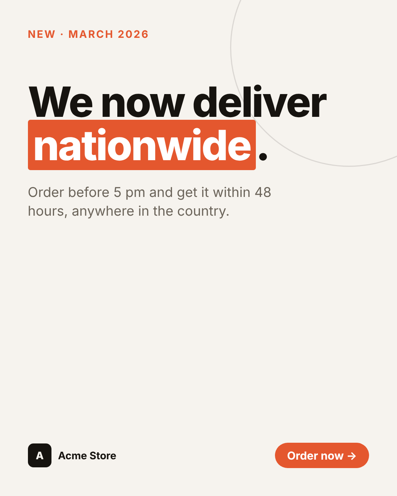
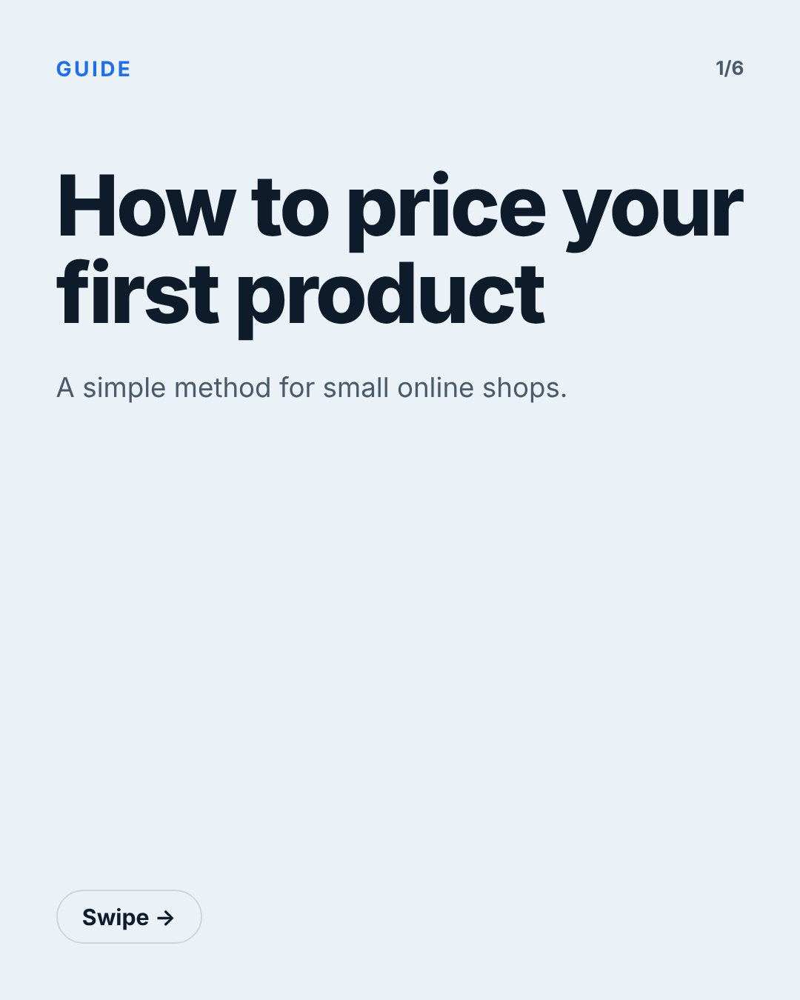
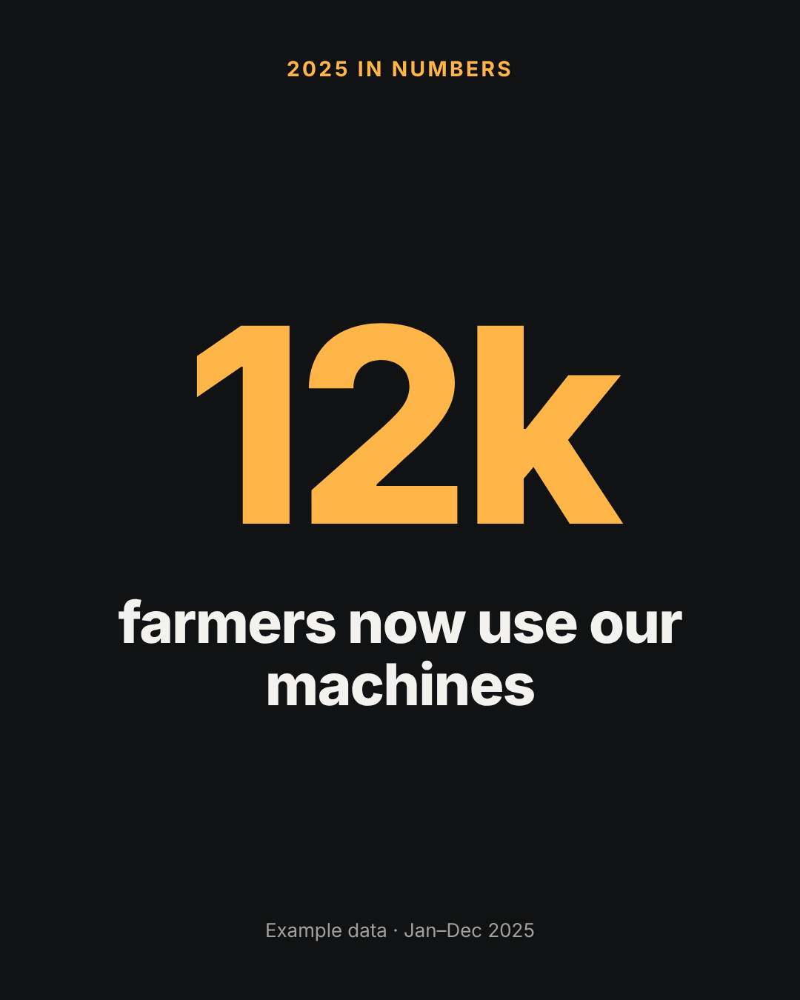
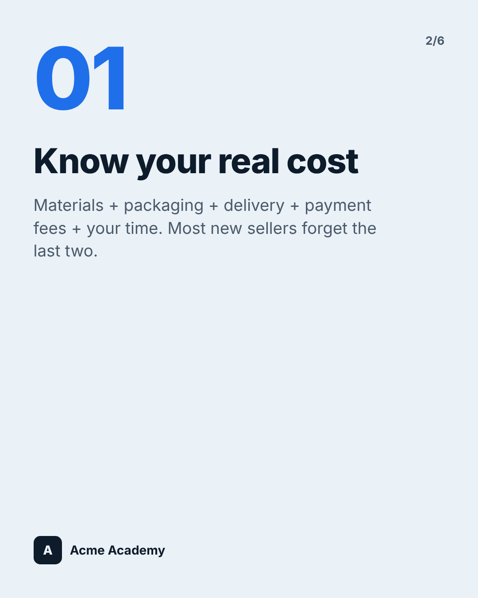
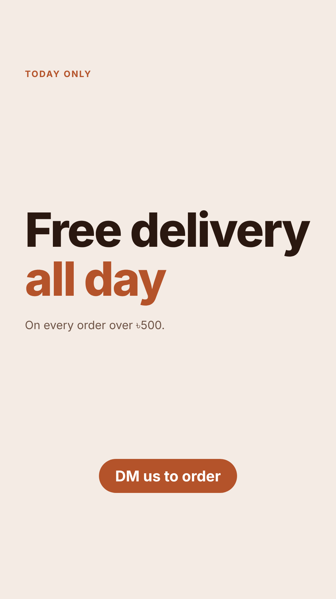
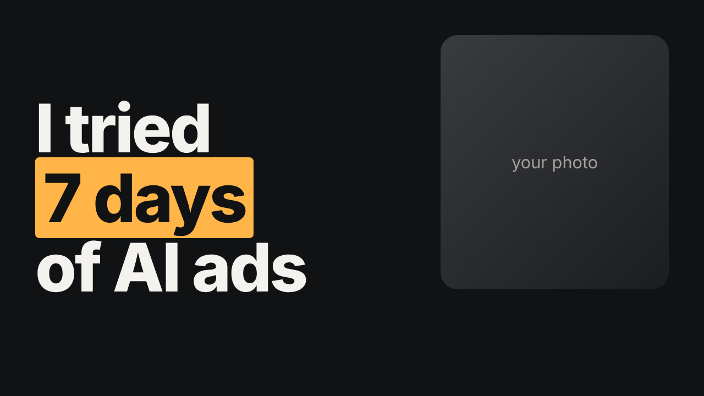

# social-post-design

**An agent skill that designs social media graphics that don't look AI-generated.**
Instagram & Facebook posts, carousels, stories, ad creatives, LinkedIn images, YouTube thumbnails and page covers — as one self-contained HTML file at exact platform sizes, self-checked, and exported to PNG.

Works with Claude Code, Codex, Cursor and any host that supports Agent Skills.



| | | |
|---|---|---|
|  |  |  |
|  |  |  |



## Why

Ask an AI agent for "an Instagram post" and you usually get a random gradient, clip-art, tiny text and the wrong size. This skill gives the agent:

- **Exact formats** — `portrait` 1080×1350, `square`, `story` 1080×1920, `landscape` 1200×628, `thumb` 1280×720, `cover` 1640×624 — with safe zones for each platform.
- **12 proven layouts** — statement, offer, stat, list, carousel, quote, split, event, hiring, product spotlight, story CTA, thumbnail.
- **An editorial design system** — big confident type, one accent colour, real whitespace, light/dark and brand palettes, everything sized in canvas units so one design re-flows across formats.
- **A self-check** (`check.py`) that catches overflow, clipped text, text too small for a phone, story UI zones and fonts that failed to load — before you see the result.
- **Export** (`export.py`) to PNG, JPG or PDF, every canvas in the file at once, optional 2× scale.
- **Honest content rules** — no invented prices, stats, testimonials or dates; placeholders instead.
- **Multilingual** — proper handling for Bangla, Arabic/Urdu and Devanagari (fonts, line height, RTL).

## Install

**Claude Code**

```
/plugin marketplace add mominbot999/social-post-design
/plugin install social-post-design@social-post-design
```

**Codex, Cursor and other Agent Skills hosts**

```bash
npx skills add mominbot999/social-post-design
```

**Manual:** copy `skills/social-post-design/` into your agent's skills folder (e.g. `~/.claude/skills/`).

For export and self-check, install Playwright once:

```bash
pip install playwright && python3 -m playwright install chromium
```

(If Google Chrome is installed, the scripts use it automatically.)

## Use

Just ask in plain language:

> Make an Instagram post announcing that we now deliver nationwide. Brand colour #2f8f4e.

> Turn these 5 tips into a carousel, portrait size.

> Design a YouTube thumbnail for "I tried 7 days of AI ads", dark theme.

> Same post in all sizes: feed, square and story.

The agent picks a format and layout, writes `design.html`, runs the self-check, exports PNGs and shows you the result.

### Scripts

```bash
python3 skills/social-post-design/scripts/check.py design.html       # self-check, exit 1 on errors
python3 skills/social-post-design/scripts/export.py design.html      # → PNG per canvas
python3 skills/social-post-design/scripts/export.py design.html -o out/ --scale 2 --format jpg
```

## Structure

```
skills/social-post-design/
├── SKILL.md                 # entry point the agent reads
├── references/
│   ├── formats.md           # sizes and safe zones
│   ├── style.md             # palettes, type, non-Latin scripts, composition
│   └── layouts/*.md         # one file per layout, loaded only when needed
├── assets/
│   ├── base.css             # the design system
│   └── template.html
└── scripts/
    ├── check.py             # self-check
    └── export.py            # PNG / JPG / PDF export
examples/                    # source of the gallery above
.claude-plugin/              # Claude Code plugin + marketplace manifests
```

## Contributing

New layouts, palettes, platform formats and language support are very welcome. Each layout is one small Markdown file plus an example — a great first PR. See [CONTRIBUTING.md](CONTRIBUTING.md).

## License

MIT © Momin
